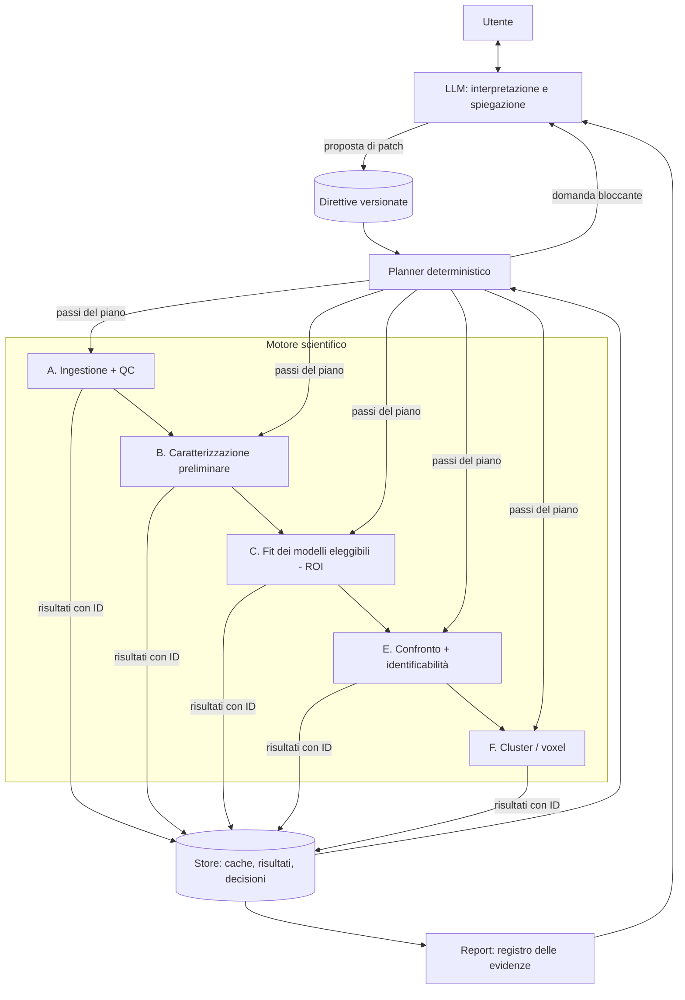

# InteractiveIdentificationPETData (IIPD) — documento di pianificazione

Stato: **pianificazione**, nessun codice IIPD scritto. Data: 2026-11-03.
Repository di partenza: `vb_pet` (branch `python-port`, albero di lavoro con
modifiche in corso: i riferimenti `file:riga` sotto si riferiscono a
quello stato e possono spostarsi).

Convenzioni usate nel documento:

- **[ESISTE]** capacità presente nel codice, con riferimento al file;
- **[PROPOSTA]** estensione da costruire;
- **[DA VERIFICARE]** ipotesi o affermazione non ancora controllata (su codice,
  dati o letteratura).

---

## 0. Decisioni prese (2026-11-03) e loro impatto

| # | Decisione | Prima |
|---|---|---|
| **D1** | Ambito prioritario: **PET dinamica whole-body / total-body**. Il cervello resta supportato dallo stesso motore, ma non guida l'MVP | domanda B2 |
| **D2** | IIPD in un **repository separato**; **eredita i metodi di fitting da `vbpet`**, che diventa una dipendenza | domanda B3 |

### 0.1 Cosa cambia con il whole-body

- **Input**: il caso standard è l'**IDIF** da una label vascolare (aorta
  discendente, ventricolo sinistro) della segmentazione d'organo; il prelievo
  arterioso è l'eccezione. Il QC dell'input (§3.2-A) si estende a: volume
  parziale e spillover nella label vascolare, frame precoci abbastanza brevi da
  campionare il picco, rapporto plasma/sangue, metaboliti (trascurabili per FDG,
  **sconosciuti** per molti traccianti nuovi → assunzione esplicita e analisi di
  robustezza). Oggi `vbpet` usa un rapporto plasma/sangue costante e lo stesso
  segnale per Cp e Cb (§2.3, punto 5).
- **Delay e dispersione per organo**: con un FOV assiale lungo l'arrivo del bolo
  varia lungo il corpo (Li et al. 2022) e nel polmone conta anche la dispersione
  (Wang et al. 2023). Il delay esiste già (`Model.with_delay`); la dispersione
  manca e **entra nell'MVP** (M2) invece che in M6.
- **Insiemi di candidati per organo**: il planner non cerca un modello globale.
  Ogni organo ha requisiti propri:

  | Organo / regione | Particolarità | Conseguenza |
  |---|---|---|
  | fegato | doppio input (arteria epatica + vena porta); identificabilità studiata da Zuo et al. 2019 | modelli a singolo input fittati con avviso "assunzione violata"; ESA **non applicabile** (input non unico); modello a doppio input prioritario in M6 |
  | polmone | frazione di aria/tessuto, dispersione | delay + dispersione, Vb elevato |
  | miocardio | spillover dal ventricolo sinistro | termine di spillover come variante del registro **[PROPOSTA]** |
  | reni, vescica, colecisti | escrezione, attività non compartimentale | solo descrittivi; marcati "fuori modello", mai usati per conclusioni cinetiche |
  | muscolo | 5K per FDG (Bertoldo et al. 2001) | già nel registro |
  | cervello | come nel resto del documento | — |
  | lesioni | eterogenee, spesso non segmentate | livello cluster/voxel (§3.2-F) |

- **Modelli reference-region**: in generale non esiste un organo di riferimento
  valido nel corpo; restano nel registro ma non sono nel percorso principale
  dell'MVP.
- **Spectral analysis**: valida con un singolo input (anche IDIF) per la maggior
  parte degli organi, non per il fegato. Con FDG e molti traccianti oncologici
  irreversibili, **SAIF** diventa più rilevante (domanda B1 ancora aperta).
- **Cinetica precoce**: il total-body consente frame precoci molto brevi
  (Feng et al. 2021); K1 e Vb diventano più identificabili, e i protocolli brevi
  rendono più frequente il caso "reversibilità non decidibile".
- **Segmentazione**: dseg d'organo (TotalSegmentator/MOOSE) ricampionata su
  griglia PET, come già in `vbpet`; percorso organo → cluster → voxel naturale.
  Organi piccoli e bordi: volume parziale e registrazione da segnalare nel QC.
- **Dimensioni**: lo stadio voxel resta in `vbpet` (caricamento a blocchi,
  `load_masked`), su DEI.

### 0.2 Cosa cambia con il repository separato

- `iipd` è un pacchetto Python che dipende da `vbpet` installato da git con
  **commit o tag fissato** (`python-port` non è ancora in `master`). In sviluppo:
  installazione editabile dei due repository affiancati.
- IIPD usa solo una **superficie dichiarata** dell'API di `vbpet`, coperta da
  test di integrazione nel repository IIPD:
  `models.get_model`, `models.base.{Model, Frames, PlasmaInput}`, `conv`,
  `input.make_plasma_input`, `models.reference.reference_input`,
  `regional.{roi_tacs, frame_weights, wnlls, fit_regions, make_priors}`,
  `vb.core.{fit_vb, VBOptions}`, `vb.spatial`,
  `voxel.{voxel_priors, fit_voxels, qc_flags}`, `io.bids`, `io.derivatives`.
- **Dove vanno le modifiche al fitting**. Ciò che è generico va in `vbpet`, con
  PR separate e solo con il tuo consenso, visto che `vbpet` è in sviluppo
  attivo:
  - bound superiori in `Model`;
  - `wnlls` che restituisce tutti i minimi del multistart e il numero di
    condizione, invece della sola `pinv`;
  - protezione della divisione in 2TCM1K e 5K;
  - LM batch in JAX;
  - dispersione accanto al delay;
  - Patlak e Logan (Patlak è già previsto in `DESIGN.md`).

  Ciò che è specifico di IIPD resta in `iipd`: metadati del registro, metodi
  esplorativi (ESA), valutazione, planner, direttive, store, report, LLM.
  Finché una modifica non è in `vbpet`, IIPD la **avvolge** (es. un proprio
  ciclo multistart che chiama `least_squares` sul modello compilato di `vbpet`),
  senza forkare il codice.
- Questo documento migra nel nuovo repository in M0. Il nuovo repository avrà
  il proprio `PROVENANCE.md` (regola di progetto).

---

## 1. Obiettivo, utenti, limiti d'uso

### 1.1 Obiettivo

IIPD è un framework per **identificare e fittare modelli di dati PET dinamici**,
anche per traccianti nuovi o poco caratterizzati, guidato da una conversazione in
linguaggio naturale. Data una serie di TAC (o un'immagine 4D con segmentazione)
e le informazioni disponibili su acquisizione, input e tracciante, IIPD:

1. verifica che i dati siano utilizzabili e dichiara cosa manca;
2. esplora i dati con metodi economici (descrittivi, grafici, spectral analysis);
3. sceglie, in modo tracciabile, quali modelli siano **applicabili**;
4. li fitta con strategie robuste e quantifica l'incertezza;
5. li confronta con criteri espliciti, separando due domande diverse:
   - **quale modello descrive meglio i dati** (adeguatezza / parsimonia);
   - **cosa i dati consentono di identificare** (parametri e quantità derivate
     stimabili con precisione utile, e sotto quali assunzioni);
6. scende eventualmente da organo/ROI a cluster e voxel;
7. produce un report che dice cosa è supportato, cosa resta ambiguo e cosa
   servirebbe per decidere.

Esiti ammessi (non solo "il modello migliore è X"):

| Esito | Esempio |
|---|---|
| Un modello preferito, alternative escluse con motivazione | 2TCM preferito; 1TCM escluso per residui strutturati in tutte le ROI |
| Insieme di modelli indistinguibili, stima di interesse robusta | 2TCM e irr2TCM indistinguibili su 60 min, ma Ki concorda entro il 4% |
| Insieme indistinguibile, stima di interesse **non** robusta | VT dipende dal modello oltre la sua incertezza → serve acquisizione più lunga |
| Parametro non identificabile | k4 con profilo di likelihood piatto; VT identificabile |
| Dati insufficienti / informazione mancante | senza frazione di parent non si può distinguere metabolita in tessuto da legame lento |

### 1.2 Utenti

- **Non esperto** (clinico, biologo, chimico che sviluppa il tracciante): sa
  cosa vuole misurare in termini biologici, non conosce i modelli. Ha bisogno di
  domande guidate e di spiegazioni.
- **Esperto** (modellista PET): vuole controllare modelli, pesi, criteri e
  soglie, eseguire analisi mirate e ispezionare ogni decisione.
- **Sviluppatore / validatore**: usa la modalità esaustiva (*audit*) per
  verificare il planner.

### 1.3 Limiti d'uso (da dichiarare nel software e nei report)

- Strumento di **ricerca**, non dispositivo medico; nessuna decisione clinica.
- Non sostituisce la validazione di un tracciante (blocking, test-retest,
  metaboliti, dosimetria): può suggerire quali esperimenti mancano, non
  surrogarli.
- Una proprietà cinetica stimata (es. "componente irreversibile") **non** è una
  conclusione biologica (es. "il tracciante è intrappolato nelle cellule
  tumorali"): IIPD riporta la prima e segnala la distanza dalla seconda.
- Le conclusioni valgono per il protocollo osservato (durata, campionamento,
  input): IIPD non estrapola oltre.
- Dati di pazienti: l'uso di un LLM esterno è subordinato a una decisione sulla
  privacy (§9, domanda B4).

---

## 2. Inventario del progetto esistente (`vbpet`)

Fonti lette: `DESIGN.md`, `README.md`, `PROVENANCE.md`, `pyproject.toml`, tutto
`vbpet/`, `tests/`, `scripts/`, log dei job in `jobs/logs/`. Non esiste un
`CLAUDE.md` di progetto. Il codice è ~2.5k righe Python/JAX.

### 2.1 Componenti riutilizzabili

| Componente | Dove | Cosa fa | Uso in IIPD |
|---|---|---|---|
| Interfaccia modello | [vbpet/models/base.py:34](../../vbpet/models/base.py#L34) `Model` | nome, `param_names`, `p0`, `predict_fn(theta, inp, frames)`, `derived` (VT, Ki…), `lower`, `prior_sd_min` | **[ESISTE]** nucleo del registro; va arricchito di metadati (§4.2) |
| Parametri fissi | `base.py:65` `Model.fix` | modello ridotto con parametri bloccati | **[ESISTE]** per modelli annidati (k4=0, Vb fisso) |
| Ritardo dell'input | `base.py:87` `Model.with_delay` | parametro `delay` (input traslato) | **[ESISTE]** |
| Derivati + varianza | `base.py:109` `derived_with_var` | delta method con gradienti autodiff | **[ESISTE]** |
| Tempi dei frame | `base.py:10` `Frames` | start/end/mid | **[ESISTE]** |
| Modelli plasma-input | [vbpet/models/plasma.py:116](../../vbpet/models/plasma.py#L116) `_SPECS` | 1TCM, 2TCM, 2TCM1K, irr2TCM (3K), 1K, 5K, tutti con Vb e sangue intero | **[ESISTE]** |
| Modelli reference-region | [vbpet/models/reference.py:59](../../vbpet/models/reference.py#L59) | SRTM, SRTM2 (k2' dalla mediana dei fit SRTM, `k2p_from_srtm` :74) | **[ESISTE]** |
| Convoluzione e campionamento | [vbpet/conv.py](../../vbpet/conv.py) | `exp_conv` rect/linear esatta per input lineare a tratti (:32); `sample_frames` `mid` o **media sul frame** (:64) | **[ESISTE]**: l'integrazione sulla durata dei frame è già disponibile (`mean`) |
| Input function | [vbpet/input.py](../../vbpet/input.py) | griglia uniforme, scala unità, shift (:23) | **[ESISTE]** |
| Lettura BIDS-PET | [vbpet/io/bids.py](../../vbpet/io/bids.py) | run, tempi frame, unità (`unit_factor` :26), sangue grezzo e `bloodstream` (:127, :143), dseg su griglia PET (:205), caricamento mascherato frame per frame (:240) | **[ESISTE]** base dell'ingestione |
| TAC regionali | [vbpet/regional.py:19](../../vbpet/regional.py#L19) `roi_tacs` | media per label | **[ESISTE]** |
| Pesi | `regional.py:39` `frame_weights` | `matlab` sqrt(Δt/C), `duration`, `uniform` | **[ESISTE]** parziale (§4.3) |
| WNLLS multistart | `regional.py:62` `wnlls` | scipy `least_squares` TRF con bound, 5 start con jitter, cov asintotica, WRSS, AIC, BIC | **[ESISTE]** base del fitting ROI |
| Prior regionali | `regional.py:154` `make_priors` | media = stima ROI, sd = λ·media, fallback su ROI con CV alto | **[ESISTE]** |
| VB per voxel | [vbpet/vb/core.py:224](../../vbpet/vb/core.py#L224) `fit_vb` | VB linearizzato batch (vmap), output `m`, `cov`, **free energy `F`**, rumore `s,c`, `n_iter`, fit; ARD opzionale | **[ESISTE]** livello voxel |
| Prior spaziale | [vbpet/vb/spatial.py](../../vbpet/vb/spatial.py) | MRF sulle deviazioni dalla media regionale, φ appreso, bordi tra ROI tagliabili | **[ESISTE]** |
| Stadio voxel + QC | [vbpet/voxel.py](../../vbpet/voxel.py) | prior per voxel (:11), fit (:32), flag QC: parametro al bound, max iter, derivato non finito (:73) | **[ESISTE]** |
| Derivati BIDS | [vbpet/io/derivatives.py](../../vbpet/io/derivatives.py) `RunWriter` | TSV/NIfTI con sidecar JSON (modello, pesi, input, unità) | **[ESISTE]** base per la provenienza |
| Pipeline | [vbpet/cli.py:142](../../vbpet/cli.py#L142) `process_run` | dati → input (sangue/IDIF/reference) → stadio 1 → stadio 2 → derivati | **[ESISTE]** un modello per esecuzione |
| Test | `tests/test_core.py`, `test_matlab_compat.py`, `test_bids_app.py` | convoluzione vs analitico, recupero parametri senza rumore, float32, prior spaziale, recupero del delay, confronto MATLAB, BIDS end-to-end | **[ESISTE]** |
| Generatori sintetici | `tests/synthetic.py` (input di Feng, framing tipo ds004869); `scripts/make_wholebody_phantom.py` (fantoccio total-body FDG, delay testa-piedi) | **[ESISTE]** ma usano gli **stessi** modelli del fitting (§8.2) |
| Validazione reale | `tests/validate_petfit.py`, `testdata/out/validation/` | 2TCM regionale vs `petfit` su ds004869 sub-01: differenza mediana K1 0.6%, VT 0.08% (conv linear, mid) | **[ESISTE]** |
| Dati | `testdata/ds004869/` (sub-01, [11C]MC1, sangue manuale, `bloodstream`, `petprep`, `petfit`); `testdata/phantom_wb/` | **[ESISTE]** (solo 1 soggetto per regola di progetto, vedi `PROVENANCE.md`) |
| Calcolo | `jobs/*.sbatch`, env su DEI | esecuzione via SLURM | **[ESISTE]** |

### 2.2 Cosa manca per IIPD

| Mancanza | Nota |
|---|---|
| Metodi grafici (Patlak, Logan, MA1) | `DESIGN.md` elenca Patlak in `plasma.py`, ma **non è implementato** (`_SPECS` non lo contiene) |
| Spectral analysis e varianti filtrate | assente |
| Registro con metadati (requisiti di input, ipotesi, stimandi, annidamenti, bound superiori, note di identificabilità) | `Model` ha solo nomi, p0, bound inferiori |
| Bound superiori | `wnlls` li accetta (`upper`), ma nessun modello li definisce |
| Confronto tra modelli | `process_run` fitta **un** modello; AIC/BIC calcolati ma mai confrontati |
| Diagnostica dei residui, stabilità multistart, profile likelihood, bootstrap | assenti (il multistart tiene solo il minimo migliore) |
| Identificabilità strutturale | assente |
| Contratto dati esplicito, QC dei dati | caricamento sì, controlli no (vedi assunzioni silenziose sotto) |
| Livello cluster/supervoxel | assente |
| Planner, direttive, cache, tracciamento esperimenti, report, LLM | assenti |

### 2.3 Assunzioni implicite nel codice attuale che IIPD deve rendere esplicite

Sono scelte ragionevoli per una BIDS-App, ma in IIPD diventano assunzioni da
dichiarare e, dove serve, da chiedere all'utente.

1. `load_blood_raw` ([bids.py:182-189](../../vbpet/io/bids.py#L182)): se manca il
   plasma usa il sangue intero, se manca il sangue intero usa il plasma, se manca
   la frazione di parent usa **1** (nessuna correzione metaboliti).
2. `unit_factor` (`bids.py:26`): unità sconosciuta → fattore 1 con solo un warning.
3. `make_plasma_input` (`input.py:39`): oltre l'ultimo campione l'input resta
   costante all'ultimo valore.
4. `reference_input` (`reference.py:22`): TAC di riferimento interpolata ai
   mid-frame con C(0)=0.
5. IDIF (`cli.py:206-211`): rapporto plasma/sangue costante (`--idif-plasma-ratio`),
   stesso segnale per Cp e Cb, nessuna correzione per partial volume o metaboliti.
6. Pesi `matlab` (`regional.py:43`): sd ∝ sqrt(C/Δt), con C la TAC **misurata**
   (pesi dipendenti dai dati; frame con C ≤ 0 scartati).
7. Covarianza WNLLS con `pinv` (`regional.py:108`): una matrice J'J singolare
   (sintomo di non identificabilità) produce comunque una covarianza finita.
8. `predict_2tcm1k` (`plasma.py:61-62`, e così `predict_5k` :91) divide per `b1-b2` senza la protezione
   `_div` usata negli altri modelli. **[DA VERIFICARE]** comportamento quando
   b1 = b2.
9. `DESIGN.md` §2.2 descrive un LM batch in JAX per lo stadio regionale; il
   codice usa scipy, sequenziale, su CPU (`regional.py:116`). Per IIPD (molti
   modelli × ROI × start × bootstrap) un fitting batch è utile (§5.4).

### 2.4 Ipotesi da verificare sul riuso

- **[DA VERIFICARE]** La free energy `F` del VB è confrontabile tra modelli solo
  a parità di dati, pesi e **prior**. In `vbpet` i prior derivano dal fit
  regionale dello stesso modello sugli stessi dati (empirical Bayes): `F` non è
  quindi una log-evidence "pulita" e il confronto tra modelli tramite `F` con
  questi prior è distorto a favore dei modelli più flessibili. Per la selezione
  a livello voxel servono prior comuni o indipendenti dai dati del soggetto (§4.6).
- **[DA VERIFICARE]** AIC/BIC in `wnlls` usano `nd·log(WRSS/nd)`: corretti per
  il confronto tra modelli fittati sulla **stessa** TAC con gli **stessi** pesi; non
  includono la correzione AICc per n piccolo (tipicamente 20-40 frame).

---

## 3. Workflow scientifico

### 3.1 Panoramica



Regola di separazione: **l'LLM non calcola e non scrive risultati**. Legge
risultati tramite ID, propone modifiche alle direttive che vengono validate,
chiede al planner di eseguire passi. Ogni numero nel report proviene dallo store.

### 3.2 Fasi

Per ogni fase: input, output, controlli, dipendenze, condizioni di arresto.

#### A. Ingestione e controllo qualità

**Input**: dataset BIDS-PET (via `vbpet.io.bids`) oppure tabella di TAC + JSON di
metadati; direttive iniziali.
**Output**: `DatasetRecord` validato (§4.1), `QCReport`, elenco di **lacune
informative** con l'effetto di ciascuna sui modelli eleggibili.

Contratto minimo (**obbligatorio**):

| Campo | Perché |
|---|---|
| tempi di inizio e durata dei frame (s), senza sovrapposizioni | campionamento del modello, integrazione sul frame |
| almeno una TAC (ROI) o immagine 4D + segmentazione su griglia PET | dati |
| unità di attività (o dichiarazione "unità relative") | coerenza con l'input |
| stato della correzione del decadimento (sì/no, tempo di riferimento) | pesi, coerenza input/tessuto |
| radionuclide (emivita) | pesi da conteggi, correzione del decadimento |
| tracciante (nome) | report; prior di letteratura solo se l'utente li fornisce |

**Opzionale**, ma determina quali modelli sono eleggibili:

| Informazione | Abilita | Se manca |
|---|---|---|
| plasma arterioso totale + frazione di parent (correzione metaboliti) | modelli plasma-input, SA, Patlak/Logan con input plasmatico | solo reference-region o descrittivi; se c'è plasma ma non la frazione di parent, l'assunzione "parent fraction = 1" va **confermata** dall'utente |
| sangue intero | termine Vb·Cb | si usa il plasma come proxy e lo si dichiara; oppure si chiede il blood-to-plasma ratio |
| blood-to-plasma ratio (costante o curva) | conversione plasma ↔ sangue | domanda all'utente se servono entrambi |
| modello della frazione di parent (es. Hill, esponenziali), con incertezza | analisi di robustezza all'input (§3.2-E) | robustezza all'input limitata alla perturbazione delle curve date |
| IDIF (label vasale) e correzioni (PVE, rapporto plasma/sangue) | plasma-input senza prelievi | dichiarare le assunzioni del punto 5 di §2.3 |
| regione di riferimento e motivazione (assenza di legame specifico) | SRTM, SRTM2, RS con riferimento | i modelli reference-region restano **non eleggibili** finché la validità non è dichiarata |
| correzioni applicate (attenuazione, scatter, randoms, decadimento, movimento, PVC) | interpretazione di residui e QC | segnalazione; nessun blocco |
| dose iniettata, peso | SUV descrittivo | nessun SUV |
| tempo di iniezione vs inizio acquisizione | delay, primo frame | delay stimato o chiesto |

Controlli QC (ogni controllo ha un esito `ok | warn | fail` e un messaggio):

1. Frame: monotoni, durate > 0, buchi e sovrapposizioni, durata totale.
2. Valori: NaN, infiniti, negativi (quanti, in quali frame), saturazione.
3. Unità: fattore noto; coerenza di scala input/tessuto (es. la TAC di una label
   vascolare, se presente, è confrontabile col sangue intero nella coda; il
   rapporto VT plausibile non è un controllo di unità e non va usato come tale).
4. Decadimento: TAC e input con lo stesso stato di correzione.
5. Input: copertura temporale fino a fine scansione (altrimenti la regola di
   estrapolazione di `input.py:39` diventa un'assunzione dichiarata), picco ben
   campionato, frazione di parent monotona e in [0,1], AUC.
6. Campionamento: numero di frame durante il picco dell'input; frame iniziali
   lunghi rispetto al picco → avviso su Vb e delay.
7. Rumore: stima per frame (dai residui di uno smoothing, o dalla varianza tra
   voxel della ROI / n) e SNR per ROI; serve per pesi e per decidere se un
   metodo esplorativo è applicabile.
8. Movimento: se disponibili, parametri di riallineamento (es. dai derivati
   PETPrep); altrimenti un indicatore grezzo (salti del baricentro dell'attività
   tra frame consecutivi). Esito solo `warn`: IIPD non corregge il movimento.
9. Delay: ritardo tra salita dell'input e salita delle TAC (rilevante nel
   total-body).

Condizioni di arresto: manca un campo obbligatorio → arresto con domanda;
`fail` su unità/decadimento → arresto finché l'utente non conferma o corregge.

Dipendenze: nessuna.

#### B. Caratterizzazione preliminare

Scopo: **restringere le ipotesi e inizializzare**, non concludere. Ogni metodo
produce indicatori con il proprio grado di affidabilità; nessun indicatore
esclude da solo un modello.

| Metodo | Requisiti / ipotesi | Cosa si ricava | Rumore e durata | Costo | Uso | Saltare / inconcludente quando |
|---|---|---|---|---|---|---|
| **Descrittivi** (tempo al picco, rapporti precoce/tardivo, pendenza log-lineare tardiva, SUV se disponibile) | solo TAC | forma della curva, washout presente o no | robusti; la pendenza tardiva dipende dalla durata | trascurabile | scelta dei test successivi, report per non esperti | mai saltati; mai usati per escludere |
| **Patlak** (Patlak et al. 1983) | input plasmatico; tratto lineare dopo t* | linearità → componente irreversibile compatibile; Ki | t* da scegliere (analisi di sensibilità su più t*); tratto lineare corto con scansioni brevi | trascurabile | screening reversibile/irreversibile, Ki iniziale | input assente; tratto lineare < 3-4 frame; curvatura dipendente da t* |
| **Logan** (Logan et al. 1990) | input plasmatico (o riferimento); equilibrio dopo t* | linearità → reversibilità compatibile; VT | bias negativo di VT con rumore alto **[DA VERIFICARE: citazione specifica]** | trascurabile | screening, VT iniziale | come sopra; a livello voxel solo con cautela |
| **Spectral analysis (ESA)** (Cunningham & Jones 1993) | input plasmatico arterioso unico; sistema lineare, tempo-invariante, **non ciclico, a ingresso singolo** (Schmidt 1999) | spettro cinetico: numero di componenti risolvibili, componente di trapping (β≈0), componente vascolare (β→∞), K1 = Σα, VT = Σα/β (reversibile), Ki | il rumore crea componenti spurie, soprattutto ai bordi della griglia; la durata limita le β minime risolvibili; scelta della griglia rilevante (Veronese et al. 2016) | basso: NNLS con una matrice di basi condivisa tra TAC; vettorizzabile | screening (reversibilità, componenti), inizializzazione (le β mappano agli autovalori del 2TCM), scelta dei modelli candidati | input assente (solo varianti con riferimento); input multipli (es. fegato a doppio ingresso, metaboliti che entrano nel tessuto); componenti accumulate ai bordi della griglia; spettro instabile al bootstrap o al cambio di griglia |
| **Rank-shaping (RS)** (Turkheimer et al. 2003) | come ESA ma senza vincolo di non negatività; ottimizzato per VT di traccianti reversibili; applicabile anche con regione di riferimento | VT a basso SNR (voxel) | richiede intervallo di SNR e griglia | basso-medio | stima di VT robusta e confronto con i modelli compartimentali | tracciante non reversibile (da verificare prima) |
| **SAIF** — SA con filtro iterativo (Veronese et al. 2010; 2012) | input plasmatico; traccianti **irreversibili**; filtro passa-banda [βL, βU] che separa componenti di trapping e vascolari da quelle di equilibrio | Ki, K1, Vb a basso SNR, spettro | le prestazioni dipendono molto dal filtro; va verificato a posteriori che le componenti stimate cadano dentro la banda e non si accumulino agli estremi (Veronese et al. 2016) | basso-medio | Ki/K1 voxel-wise per traccianti irreversibili | reversibilità non esclusa; filtro non giustificabile |
| **Basis pursuit / DEPICT** (Gunn et al. 2002) e **sparse Bayesian learning** (Peng et al. 2008) | come ESA, dizionario sovracompleto | spettro sparso, parametri macro | dipende dalla regolarizzazione | basso-medio | alternativa a ESA per lo screening | — (non nell'MVP) |

Precisazioni metodologiche da riportare all'utente:

- Uno spettro **non** identifica un unico modello compartimentale: modelli
  diversi possono dare lo stesso spettro (Gunn et al. 2001; Veronese et al. 2016).
- Il numero di componenti in una ROI può riflettere **eterogeneità** tissutale
  (miscela di tessuti a 1 compartimento) e non un modello a più compartimenti;
  SA si applica a sistemi eterogenei proprio per la sua forma additiva
  (Veronese et al. 2016, §4.3). Per questo IIPD confronta lo spettro della ROI
  con quello dei cluster interni (§3.2-F) prima di trarne indicazioni sul modello.
- SA presuppone un singolo input arterioso: con modelli reference-region il
  vincolo di non negatività non è soddisfatto (Veronese et al. 2016, §7.2).

**Quale lavoro di Veronese**: ho identificato e verificato la review sulla SA
(Veronese et al. 2016), SA per la sintesi proteica con leucina (Veronese et al.
2010), SAIF (Veronese et al. 2012), lo strumento SAKE (Veronese et al. 2013) e i
lavori sull'approccio gerarchico multi-scala (Rizzo et al. 2012, 2013). Non so
quale intendessi: il piano adotta **ESA come metodo di screening nell'MVP**, con
SAIF e RS in una milestone successiva (domanda B1, §9).

Uscite della fase B: `ExplorationResult` per ROI con indicatori e loro
affidabilità (`supported | weak | inconclusive | not_applicable` + motivo);
insieme dei candidati annotato (non ridotto); inizializzazioni.

Condizioni di arresto: nessuna (la fase non può bloccare il fitting); se tutti
gli indicatori sono inconclusivi si procede con l'insieme completo dei modelli
eleggibili.

#### C. Registro dei modelli e fitting

Il registro (§4.2) distingue tre famiglie che **non sono intercambiabili**:

| Famiglia | Esempi | Stimano | Confronto lecito |
|---|---|---|---|
| Compartimentali (plasma o riferimento) | 1TCM, 2TCM, irr2TCM, 2TCM1K, 5K, SRTM, SRTM2 | microparametri e macroparametri; descrivono l'intera curva | tra loro, sulla stessa TAC, con stessi pesi e stesso input (§3.2-E) |
| Grafici | Patlak, Logan, MA1 | un macroparametro (Ki o VT) dopo t* | solo sul **valore dello stimando** (es. Ki Patlak vs Ki irr2TCM), non su criteri di fit |
| Esplorativi / data-driven | ESA, RS, SAIF, descrittivi | spettro, macroparametri | idem: concordanza dello stimando e coerenza qualitativa |

Strategia di fitting (ROI):

1. **Eleggibilità**: un modello entra solo se i suoi requisiti di input sono
   soddisfatti (dal contratto) e non è escluso dalle direttive.
2. **Inizializzazione**, in ordine: valori forniti dall'utente → derivati
   dalla SA (β → autovalori; α → K1) o dai metodi grafici → p0 di default del
   registro (oggi quelli MATLAB, `plasma.py:116`).
3. **Multistart**: campionamento in scala logaritmica entro i bound
   (Latin hypercube) più le inizializzazioni sopra; numero di start fissato dal
   budget. A differenza di `wnlls` oggi, si **conservano tutti i minimi** (per
   la stabilità, §3.2-E).
4. **Ottimizzazione vincolata**: TRF con bound inferiori **e superiori**
   (riutilizzo di `wnlls`), eventualmente in parametrizzazione logaritmica.
5. **Pesatura**: lo schema di pesi fa parte del modello statistico e va
   dichiarato. Opzioni: `matlab` (esistente), durata del frame, conteggi
   corretti per decadimento (σ² ∝ C·e^{λt}/Δt, richiede emivita e stato del
   decadimento), pesi iterativamente ricalcolati dalla predizione del modello
   (evitano la dipendenza dei pesi dal rumore della TAC stessa), uniformi.
   Lo stesso schema è usato per tutti i modelli confrontati.
6. **Integrazione sul frame**: default `mean` (media sul frame,
   `conv.sample_frames`); `mid` solo per compatibilità con MATLAB, kinfitr e petfit.
7. **Delay e Vb**: parametri da stimare o da fissare; la scelta crea varianti
   annidate dello stesso modello (es. 2TCM, 2TCM+delay, 2TCM[Vb=0.05]).
8. **Errori**: start falliti registrati (non solo scartati); fit al bound;
   J'J malcondizionata → flag di non identificabilità locale (numero di
   condizione, rango), **non** silenziata da `pinv`.
9. **Incertezza** (in ordine di costo):
   - covarianza asintotica (Fisher) e correlazioni, CV;
   - VB per ROI con prior deboli (riuso di `fit_vb`), come controllo;
   - bootstrap dei residui pesati (wild bootstrap, per l'eteroschedasticità)
     o parametrico dal modello fittato;
   - profile likelihood per i parametri e gli stimandi di interesse
     (Raue et al. 2009);
   - MCMC per ROI selezionate (dopo l'MVP).

Uscita: `FitResult` per (modello × ROI × metodo di stima), con tutti i minimi,
diagnostica e provenienza (§4.4).

#### D. Pianificazione adattiva

Planner **deterministico**, basato su regole versionate, che opera su un
grafo di passi (DAG) e su uno stato per ogni coppia (modello, ROI):

```
ineleggibile ── (requisiti soddisfatti) ──> candidato
candidato ── (fit eseguito) ──> fittato
fittato ── (valutazione) ──> supportato | indistinguibile | sfavorito | non identificabile
sfavorito ── (nuova evidenza / audit) ──> candidato      (mai cancellato)
```

Ordine dei passi (dal meno al più costoso):

| Livello | Passi | Costo indicativo |
|---|---|---|
| L0 | contratto, QC | secondi |
| L1 | descrittivi, Patlak/Logan multi-t*, ESA sulle ROI | secondi |
| L2 | fit WNLLS multistart di **tutti** i modelli eleggibili su tutte le ROI | secondi-minuti |
| L3 | confronto, residui, stabilità, Fisher, sensibilità a pesi/delay | secondi |
| L4 | bootstrap e profile likelihood sull'insieme supportato + indistinguibile | minuti |
| L5 | robustezza all'input (perturbazioni della frazione di parent, del BPR, del delay), troncamento temporale | minuti |
| L6 | cluster/supervoxel (§3.2-F) | minuti |
| L7 | voxel (VB `vbpet`, su DEI via sbatch) | minuti-ore |

Nell'MVP L2 fitta **tutti** i modelli eleggibili: con 8 modelli e decine di ROI
il costo è basso e si evita di scartare alternative in anticipo. L'adattività
riguarda i passi costosi (L4-L7): quali modelli, quali ROI, quanta
ricampionatura.

Regole (esempi; ogni regola ha un ID, una versione e soglie configurabili):

- **R-ELIG**: requisito di input mancante → `ineleggibile` con motivo.
- **R-DISFAVOR** (esclusione *soft*): un modello diventa `sfavorito` solo se,
  nella **maggioranza** delle ROI rilevanti, (a) ΔAICc > 10 rispetto al migliore
  **e** (b) residui strutturati (runs test p < 0.01), **oppure** se l'utente lo
  esclude. Mai su una singola ROI, mai sul solo errore di fit.
- **R-INDIST**: modelli con ΔAICc < 2-4 e residui non strutturati →
  `indistinguibile`; si passa a L4 per tutti.
- **R-ESCALATE**: residui strutturati in tutti i modelli → si aggiungono
  varianti (delay, Vb libero, modello più complesso) o si segnala un possibile
  modello mancante dai candidati.
- **R-NONID**: profilo piatto o |ρ| > 0.95 o CV > soglia → parametro
  `non identificabile`; si verifica se lo **stimando** di interesse resta
  identificabile.
- **R-ASK**: lo stimando richiesto dipende da un'informazione mancante (es.
  reversibilità con scansione breve, BPR) → domanda bloccante all'utente.
- **R-STOP**: stimandi richiesti identificati con incertezza sotto la soglia
  delle direttive e robusti alle perturbazioni previste; oppure budget esaurito
  (si riporta cosa non è stato fatto); oppure domanda bloccante senza risposta.

Ogni applicazione di regola produce un `DecisionRecord` (regola, versione,
input, soglie, esito). Il planner è quindi verificabile riga per riga.

**Modalità audit (esaustiva)**: esegue L2-L5 per tutti i modelli eleggibili,
tutte le ROI e tutte le varianti; confronta poi l'insieme "supportato +
indistinguibile" del planner con quello esaustivo (§8.4). Serve a validare le
regole, non all'uso corrente.

#### E. Confronto e identificabilità

Principio: **nessun punteggio aggregato**. Il report presenta un registro delle
evidenze, criterio per criterio.

**Classe di confrontabilità.** Due fit sono confrontabili con criteri di
likelihood (AIC, AICc, BIC, test F, LRT) solo se condividono: stessa TAC (hash),
stessi frame inclusi, stesso schema di pesi (valori identici), stesso modello di
rumore, stesso input (compreso il trattamento del delay e del BPR), stessa
integrazione sul frame. IIPD calcola un identificativo di classe e **rifiuta**
il confronto tra classi diverse. Modelli grafici ed esplorativi si confrontano
solo sullo stimando.

| Criterio | Quando è utilizzabile | Limiti |
|---|---|---|
| **Residui** (runs test, autocorrelazione, struttura nei frame precoci, normalità dei residui pesati) | sempre | i pesi errati creano struttura; i frame precoci riflettono delay/dispersione/Vb |
| **AICc** | stessa classe; n piccolo (frame 20-40) → preferire AICc ad AIC (Hurvich & Tsai 1989 **[DA VERIFICARE]**) | presuppone pesi corretti; con modelli annidati ai bound non quantifica la significatività |
| **BIC** | stessa classe | n = numero di frame con peso > 0; penalità forte con pochi frame |
| **Test F / LRT** | modelli annidati, stessa classe | se il vincolo è al bordo dello spazio parametrico (k4 = 0, Vb = 0) la distribuzione χ² non vale: usare bootstrap parametrico |
| **Pesi di Akaike, model averaging** | quando più modelli restano plausibili | Turkheimer et al. 2003 propongono di passare dalla selezione alla media dei modelli quando la scelta è indecidibile; la media ha senso solo per stimandi comuni (VT, Ki) |
| **Free energy VB** | stessi dati, pesi e prior **non** stimati dagli stessi dati | con i prior regionali di `vbpet` non è una evidenza confrontabile (§2.4) |
| **Validazione predittiva** | troncamento temporale (fit sui primi T' minuti, predizione del resto) | non è una cross-validation indipendente: i frame sono correlati nel tempo |
| **Leave-one-subject-out** | prior di popolazione, coorti | richiede più soggetti |
| **Stabilità all'inizializzazione** | sempre | minimi distinti con costo quasi uguale e parametri diversi → non identificabilità pratica |
| **Identificabilità strutturale** | offline, per configurazione (modello, input, parametri fissi) con DAISY (Bellu et al. 2007), SIAN (Hong et al. 2019) o GenSSI (Chiş et al. 2011) | risultato teorico, non garantisce stime precise; da precalcolare e salvare nel registro |
| **Identificabilità pratica**: profile likelihood (Raue et al. 2009), autovalori della Fisher, correlazioni, CV | ROI con SNR sufficiente | costosa per voxel; si applica a ROI e cluster |
| **Parametri al bound** | sempre | un parametro a 0 può indicare un modello sovraparametrizzato (es. k4 → irr2TCM) |
| **Plausibilità fisiologica** | intervalli forniti dall'utente o da fonti citate | per un tracciante nuovo spesso non esistono: è un avviso, non un criterio di esclusione automatico |
| **Robustezza** | perturbazioni di pesi, delay, frazione di parent, BPR, t*, integrazione mid/mean, durata della scansione | riportata come "la conclusione regge / si inverte se…" |

Lettura congiunta (esempi di frasi del report, generate da template sul
registro delle evidenze):

- "2TCM preferito a 1TCM in 14/14 ROI (ΔAICc 18-95); i residui di 1TCM sono
  strutturati nei primi 10 min. 2TCM e 2TCM+delay indistinguibili (ΔAICc < 2)."
- "k3 e k4 non identificabili separatamente (ρ = −0.98, profilo piatto verso
  l'alto); VT identificabile (CV 6%, profilo chiuso)."
- "Ki da Patlak (t* 20-40 min) e da irr2TCM concordano entro il 5%; la
  conclusione 'irreversibile' dipende dalla durata di 60 min: il test di
  troncamento mostra che con 90 min k4 sarebbe stimabile solo se > 0.005/min
  [condizione da simulazione, non da dati]."

#### F. Dall'organo al voxel

Percorso: **organo/ROI → cluster/supervoxel → voxel**.

1. **ROI/organo**: fasi A-E complete.
2. **Cluster/supervoxel** **[PROPOSTA]**: all'interno di ogni organo, cluster
   sulle TAC normalizzate o su descrittori cinetici (spettro, Patlak/Logan
   voxel-wise), con vincolo di contiguità opzionale (supervoxel). Su ogni
   cluster si ripetono C-E in forma ridotta: se l'insieme dei modelli supportati
   del cluster differisce da quello dell'organo, il cluster viene trattato come
   regione a sé (lesioni, eterogeneità). Precedente diretto: l'approccio
   gerarchico multi-scala ROI → cluster → voxel per la generazione di mappe
   parametriche (Rizzo et al. 2012; 2013).
3. **Voxel**: `vbpet` (VB con prior regionali `R` o spaziali `S`).

Tre modi diversi di usare l'informazione del livello superiore, da tenere
distinti nel report:

| Modo | Effetto | Rischio | In `vbpet` |
|---|---|---|---|
| **Inizializzazione** | solo punto di partenza | nessun bias se la convergenza è robusta | `M_init` in `fit_vb` |
| **Regolarizzazione** (prior informativo) | contrazione verso la media regionale | bias verso il regionale in voxel atipici (lesioni, bordi) | prior `R` (sd = λ·media, λ=0.5), `S` (MRF) |
| **Inferenza gerarchica** | iperparametri regionali stimati insieme ai voxel | più costosa; richiede un modello di popolazione | **[PROPOSTA]** dopo l'MVP |

Accorgimenti:

- **Modello imposto ai voxel**: prima di applicare un modello a tutti i voxel di
  un organo, verificare a livello cluster che sia supportato; mappe di residui e
  di `F` per localizzare dove il modello non regge.
- **Lesioni e strutture non segmentate**: un prior regionale le spinge verso il
  tessuto sano. Rilevazione tramite residui voxel e confronto `R` vs prior
  debole `N`; eventualmente label aggiuntiva.
- **Bordi**: effetto di volume parziale e prior che attraversano i bordi
  (`--spatial-within-roi` esiste); i voxel di bordo vanno marcati nel report.
- **Propagazione dell'incertezza**: oggi la sd del prior è λ·|media| e ignora
  l'errore della stima regionale (`make_priors`, `regional.py:154`). Proposta:
  sd ≥ max(λ|m|, k·SE_ROI), oppure prior derivati dal bootstrap regionale.
- **Confronti obbligatori nel report voxel**: prior deboli vs `R` vs `S`;
  indice di contrazione (quanto le stime voxel si avvicinano alla media
  regionale rispetto ai prior deboli); sul fantoccio, errore separato per tessuto
  omogeneo, bordi e lesioni.
- **Selezione di modello per voxel**: solo con prior comuni o indipendenti dai
  dati del soggetto (§2.4); altrimenti si riportano le mappe di un modello già
  scelto a livello cluster.

---

## 4. Contratti dati e interfacce proposte

Schemi in Python (dataclass o pydantic; scelta da fare in M0). Tutti gli oggetti
sono immutabili, serializzabili in JSON, con un `hash` di contenuto.

### 4.1 Dataset

```python
class Provenance(Enum): PROVIDED, DERIVED, ASSUMED_BY_USER, DEFAULT, MISSING

@dataclass(frozen=True)
class Field[T]:
    value: T | None
    status: Provenance
    source: str          # file, messaggio dell'utente (id), regola
    note: str = ""

@dataclass(frozen=True)
class InputFunction:
    kind: Literal["arterial", "idif", "reference", "none"]
    t_min: np.ndarray
    plasma_total: Field[np.ndarray]
    parent_fraction: Field[np.ndarray]     # MISSING ≠ "uguale a 1"
    whole_blood: Field[np.ndarray]
    blood_to_plasma: Field[float | np.ndarray]
    delay_min: Field[float]
    dispersion_corrected: Field[bool]
    reference_label: Field[str]            # se kind == "reference"
    reference_validity: Field[str]         # motivazione dichiarata

@dataclass(frozen=True)
class DatasetRecord:
    id: str; hash: str
    tracer: Field[str]; radionuclide: Field[str]; half_life_min: Field[float]
    frames: Frames                         # riuso di vbpet.models.base.Frames
    activity_unit: Field[str]
    decay_corrected: Field[bool]; decay_ref_time: Field[str]
    corrections: dict[str, Field[bool]]   # attenuation, scatter, randoms, motion, pvc
    tacs: pd.DataFrame | None              # frame × ROI
    image_4d: Path | None; dseg: Path | None; labels: dict[int, str]
    input: InputFunction
    injected_dose: Field[float]; body_weight: Field[float]
    qc: "QCReport"
```

### 4.2 Registro dei modelli

```python
@dataclass(frozen=True)
class ParamSpec:
    name: str; unit: str; lower: float; upper: float; p0: float
    scale: Literal["linear", "log"] = "log"

@dataclass(frozen=True)
class ModelSpec:
    id: str                        # "2TCM", "2TCM+delay", "2TCM[Vb=0.05]"
    family: Literal["compartmental_plasma", "compartmental_reference",
                    "graphical", "spectral", "descriptive"]
    requires: frozenset[str]       # {"plasma_parent", "whole_blood"}, {"reference_tac"}
    params: tuple[ParamSpec, ...]
    estimands: dict[str, Callable] # VT, Ki, BPnd, K1, R1 … (riuso Model.derived)
    assumptions: tuple[str, ...]   # testo + id: "reversible", "no_radiometabolites_in_tissue"
    nests: tuple[tuple[str, dict], ...]   # (modello più semplice, vincolo) es. ("irr2TCM", {"k4": 0})
    structural_identifiability: dict      # esito precalcolato per configurazione, con strumento e data
    estimators: frozenset[str]     # {"wnlls", "vb", "linear", "nnls"}
    backend: "vbpet.models.base.Model | Callable"
    references: tuple[str, ...]
```

Il `Model` di `vbpet` resta il backend numerico; `ModelSpec` aggiunge i
metadati. I modelli grafici e spettrali implementano un'interfaccia diversa
(`Estimator.estimate(dataset, roi, config) -> EstimandResult`), perché non
hanno `predict` sui frame nello stesso senso.

### 4.3 Direttive

```python
@dataclass(frozen=True)
class Directive:
    version: int; parent: int | None; created: str; author: Literal["user", "llm_proposal", "default"]
    goals: tuple[Estimand, ...]          # es. VT nelle ROI X, Ki nel tumore
    regions: tuple[str, ...]
    level: Literal["roi", "cluster", "voxel"]
    include_models: frozenset[str]; exclude_models: frozenset[str]
    assumptions: dict[str, Field]        # reversibility, reference_validity, parent_fraction_model …
    noise_model: str; weights: str; frame_sampling: str
    thresholds: dict[str, float]         # ΔAICc, CV massimo, |ρ| massimo …
    budget: Budget                       # tempo, GPU sì/no, numero di bootstrap
    explanation_level: Literal["novice", "expert"]
```

Una modifica è una `DirectivePatch` (operazioni JSON-patch) con autore e
messaggio d'origine; diventa effettiva solo dopo validazione di schema e
controlli semantici (§6.2).

### 4.4 Piano, fit, valutazioni, report

```python
@dataclass(frozen=True)
class PlanStep:
    id: str; kind: str                   # "qc", "esa", "fit", "bootstrap", "profile", …
    inputs: tuple[str, ...]              # hash degli oggetti a monte
    config: dict; directive_fields: tuple[str, ...]   # campi delle direttive da cui dipende
    cache_key: str                       # hash(kind, inputs, config, campi direttive, versione codice)
    reason: str                          # DecisionRecord che l'ha generato

@dataclass(frozen=True)
class FitResult:
    id: str; model: str; roi: str; estimator: str; comparability_class: str
    minima: tuple[Minimum, ...]          # tutti gli start: theta, costo, convergenza
    best: Minimum; cov: np.ndarray; cond_number: float
    residuals: np.ndarray; diagnostics: dict   # runs test, autocorrelazione, al bound …
    estimands: dict[str, Estimate]       # valore, sd, IC, metodo dell'incertezza
    seed: int; code_version: str; runtime_s: float

@dataclass(frozen=True)
class Assessment:
    roi: str; estimand: str
    status: dict[str, Literal["supported", "indistinguishable", "disfavored",
                              "non_identifiable", "ineligible"]]
    evidence: tuple[EvidenceItem, ...]   # criterio, valore, modelli coinvolti, result id
    robustness: tuple[RobustnessItem, ...]
    open_issues: tuple[str, ...]

@dataclass(frozen=True)
class Report:
    directive_version: int; dataset_hash: str
    assessments: tuple[Assessment, ...]; decisions: tuple[DecisionRecord, ...]
    assumptions: tuple[Field, ...]       # tutte le ASSUMED/DEFAULT, in evidenza
    limitations: tuple[str, ...]
```

---

## 5. Architettura

### 5.1 Moduli

```
iipd/
  contract/     schemi (§4.1), loader BIDS-PET (via vbpet.io.bids) e TSV+JSON
  qc/           controlli §3.2-A
  explore/      descrittivi, patlak, logan, (ma1), esa; poi rs, saif
  registry/     ModelSpec, wrapper dei modelli vbpet, tabella di identificabilità strutturale
  fit/          wnlls batch (da vbpet.regional), vb (vbpet.vb), multistart, bootstrap, profile
  assess/       classi di confrontabilità, criteri, identificabilità pratica, robustezza
  planner/      regole versionate, macchina a stati, DecisionRecord, modalità audit
  spatial/      cluster/supervoxel, ponte verso vbpet.voxel
  directives/   schema, patch, validazione, storia
  store/        cache content-addressed, DB dei run (SQLite), artefatti (Parquet/NIfTI/BIDS derivatives)
  report/       registro delle evidenze → Markdown/HTML, template delle frasi
  llm/          adattatore del provider, tool, controllo di aderenza dei numeri
  cli.py        iipd init | plan | run | audit | report | chat
```

Dipendenza: `iipd → vbpet` (mai il contrario), in repository separati, con
`vbpet` fissato a un commit o tag (§0.2). `vbpet` resta una BIDS-App autonoma.

### 5.2 Riproducibilità e tracciamento

- **Cache content-addressed**: ogni `PlanStep` ha `cache_key` =
  hash(tipo, hash degli input, configurazione, campi delle direttive da cui
  dipende, versione del codice). Un risultato già calcolato con la stessa
  chiave si riusa.
- **Seed**: ogni passo stocastico (multistart, bootstrap, cluster) riceve un seed
  derivato dal seed di sessione e dall'ID del passo; registrato nel risultato.
- **Versioni**: versione di `iipd`, `vbpet`, JAX, commit git; registrate in ogni
  risultato e nel report.
- **DB dei run**: SQLite (sessioni, direttive, passi, risultati, decisioni,
  messaggi). MLflow o simili non servono per l'MVP.
- **Output** compatibili con BIDS derivatives (riuso di `RunWriter`).

### 5.3 Parallelizzazione

- ROI × modelli × start × repliche bootstrap: fitting batch in JAX (`vmap` di un
  Levenberg-Marquardt con bound per proiezione o in parametrizzazione log) —
  da sviluppare, oggi `wnlls` è sequenziale. Fino ad allora: processi paralleli
  su CPU.
- Voxel: `vbpet` su DEI tramite `sbatch` (regola di progetto); IIPD genera il job
  e ne legge gli output.

### 5.4 Perché un planner deterministico nell'MVP

- Verificabilità: ogni decisione ha una regola e soglie leggibili.
- Riproducibilità: stesse direttive e dati → stesso piano.
- Validabilità: si confronta con la modalità esaustiva.
- L'autonomia dell'LLM non aggiunge capacità scientifica dove le regole sono
  note; la aggiunge nell'interpretazione delle richieste e nella spiegazione.

Componenti più autonomi da valutare **dopo** l'MVP, sempre dentro il perimetro
dei tool: (a) l'LLM propone un nuovo modello candidato (es. 3TCM, doppio
input) come `ModelSpec` da approvare e testare sul sintetico prima dell'uso;
(b) l'LLM suggerisce esperimenti aggiuntivi (durata, campionamento) motivandoli
con simulazioni eseguite dal motore (design sperimentale, cfr. Muzic et al. 1996).

---

## 6. Interazione tramite LLM

### 6.1 Tre livelli

| Livello | Responsabilità | Non può |
|---|---|---|
| LLM | capire richieste, fare domande, proporre `DirectivePatch`, chiamare tool, spiegare risultati | calcolare numeri, scrivere nello store, inventare valori di parametri o fonti |
| Direttive validate | stato esplicito di obiettivi, vincoli, assunzioni, preferenze | contenere valori senza stato di provenienza |
| Motore scientifico | QC, fitting, valutazione, planner, report | interpretare il linguaggio naturale |

Tool esposti all'LLM (lista chiusa): `get_state`, `get_missing_info`,
`propose_directive_patch`, `preview_plan_change` (cosa verrebbe invalidato),
`run_plan(until=...)`, `get_result(id)`, `get_assessment(roi, estimand)`,
`explain_decision(decision_id)`, `list_models`.

### 6.2 Direttive dinamiche: versioni, conflitti, invalidazione

- **Storia append-only**: ogni patch crea una nuova versione con genitore,
  autore e messaggio d'origine. Si può tornare a una versione precedente.
- **Valori dedotti dall'LLM** (es. "l'utente sembra intendere VT") restano
  `llm_proposal` finché l'utente non li conferma, se cambiano i risultati.
- **Conflitti**:
  1. *direttiva vs direttiva*: vince l'affermazione esplicita più recente
     dell'utente; l'LLM la riformula e chiede conferma se contraddice una
     precedente;
  2. *direttiva vs requisiti*: es. "usa solo 2TCM" senza input plasmatico →
     rifiuto motivato del motore;
  3. *direttiva vs evidenza*: es. "il tracciante è irreversibile" ma Patlak non
     è lineare e 2TCM con k4 > 0 è preferito → la direttiva resta (è
     un'assunzione dell'utente), il report mostra l'evidenza contraria e la
     sensibilità della conclusione a quell'assunzione. Mai sovrascrittura
     silenziosa in nessuno dei due sensi.
- **Invalidazione**: ogni `PlanStep` dichiara i campi delle direttive da cui
  dipende. Una patch invalida solo i passi a valle dei campi modificati
  (es. cambiare le soglie di ΔAICc rifà la valutazione ma non i fit; cambiare i
  pesi rifà fit e valutazioni ma non QC né ESA). `preview_plan_change` mostra
  all'utente cosa verrà rieseguito prima di applicare la patch.

### 6.3 Niente valori inventati

- Ogni numero in un testo dell'LLM deve citare un `result_id`. Un controllo
  automatico estrae i numeri dal testo e verifica che compaiano (con
  arrotondamento) nei risultati citati; se no, il testo viene rigenerato o
  marcato.
- Valori di letteratura proposti dall'LLM (es. intervalli tipici di K1) entrano
  solo come `ASSUMED_BY_USER` dopo conferma esplicita e con fonte indicata;
  senza fonte restano "suggerimento non verificato" e non entrano nei calcoli.
- L'intero framework funziona **senza LLM** (direttive in YAML, `iipd run`),
  così l'LLM non è mai un requisito per la riproducibilità.
- Provider: interfaccia astratta; default ipotizzato Claude via API con tool use
  (`claude-opus-5-5` per la conversazione, un modello più piccolo per la
  verifica dei numeri). La scelta dipende dalla domanda B4 (privacy).

### 6.4 Esempio 1 — utente non esperto (illustrativo, numeri fittizi)

> **Utente**: Ho uno studio dinamico di 60 minuti con un nuovo tracciante per
> FAP in pazienti con tumore al polmone. Ho anche dei prelievi di sangue
> arterioso. Vorrei sapere quanto tracciante si lega al tumore.
>
> **Assistente**: Ho caricato i dati: 28 frame, 0-60 min, unità Bq/mL, corretti
> per il decadimento (dal file JSON). Per i prelievi mi servono tre
> informazioni, perché cambiano i modelli che posso usare:
> 1. I valori nel file sono plasma o sangue intero?
> 2. È stata misurata la frazione di tracciante non metabolizzato (parent)? Se
>    non c'è, posso procedere solo assumendo che non ci siano metaboliti
>    radioattivi, e lo scriverò nel report come assunzione.
> 3. Oltre al tumore, quali regioni ti interessano (es. polmone sano come
>    confronto)?
>
> **Utente**: Plasma. Frazione di parent sì, è nella colonna
> `metabolite_parent_fraction`. Polmone sano e tumore.
>
> **Assistente**: Grazie, aggiorno l'impostazione (versione 2). Prima faccio
> alcune analisi rapide. [run_plan fino a L3]
>
> Risultati principali, ciascuno con il riferimento all'analisi:
> - Nel tumore la curva continua a salire fino a 60 min e il grafico di Patlak
>   è lineare da circa 15 min in poi [R-031]: il comportamento è compatibile con
>   un accumulo che, entro 60 min, non viene rilasciato.
> - Ho confrontato 5 modelli. Due descrivono il tumore in modo equivalente
>   [A-007]: uno con accumulo irreversibile e uno con un rilascio molto lento.
>   I dati di 60 min non consentono di distinguerli.
> - La misura che ti interessa, la velocità netta di accumulo (Ki), è quasi la
>   stessa nei due modelli: 0.021 e 0.020 mL/cm³/min, con differenza minore
>   dell'incertezza [A-007, E-012].
> - La velocità di rilascio, invece, non è determinabile da questi dati [P-004].
>
> In sintesi: il valore di Ki nel tumore è affidabile; non è possibile dire se il
> legame sia davvero irreversibile. Per deciderlo servirebbe un'acquisizione più
> lunga o uno studio di spiazzamento. Nota: "accumulo irreversibile" è una
> proprietà della curva, non dimostra da sola un legame specifico al bersaglio.
> Vuoi che proceda con le mappe voxel per vedere se il tumore è omogeneo?

### 6.5 Esempio 2 — utente esperto (illustrativo, numeri fittizi)

> **Utente**: Candidati: 2TCM e 2TCM+delay, escludi 1TCM. Pesi da conteggi
> corretti per il decadimento. BPR costante 0.95. Profile likelihood su k4 e VT
> in putamen e cervelletto, 200 bootstrap wild.
>
> **Assistente**: Patch proposta (v3 → v4):
> `exclude_models += {1TCM}`, `weights = decay_counts`,
> `input.blood_to_plasma = 0.95 (ASSUMED_BY_USER)`,
> `profile = {k4, VT} × {putamen, cerebellum}`, `bootstrap = 200, wild`.
> Due punti prima di applicarla:
> - I pesi `decay_counts` richiedono l'emivita e lo stato del decadimento: ci
>   sono (C-11, corretto a t=0). OK.
> - Nel file c'è già il sangue intero misurato [D-001]. Con un BPR costante lo
>   sostituirei; preferisci tenere la curva misurata per il termine Vb e usare
>   0.95 solo dove manca?
>
> Anteprima: cambiano i pesi, quindi vengono rifatti 28 fit e le valutazioni;
> QC, ESA e Patlak/Logan restano dalla cache.
>
> **Utente**: Tieni il sangue intero misurato.
>
> **Assistente**: Applicata come v4 (BPR non usato). [run_plan fino a L4]
> - Putamen: 2TCM vs 2TCM+delay ΔAICc = 1.3 [A-021], indistinguibili; delay
>   stimato 0.12 ± 0.09 min.
> - Profilo di k4 aperto verso l'alto in entrambe le regioni [P-011, P-012]:
>   k4 non identificabile; profilo di VT chiuso, CV 5% (putamen) e 7%
>   (cervelletto) [P-013, P-014]; le CV bootstrap sono coerenti (6%, 8%)
>   [B-003].
> - Con i pesi `matlab` (v3) VT del cervelletto era più alto del 3%
>   [confronto A-015 vs A-022]: entro l'incertezza.
>
> Decisioni del planner: R-INDIST (v1.2) su putamen; R-NONID (v1.0) su k4
> [D-104, D-105]. Vuoi il model averaging di VT con i pesi di Akaike?

---

## 7. MVP

### 7.1 Inclusioni (motivate)

| Inclusione | Motivo |
|---|---|
| Livello ROI/organo | è dove identificabilità e confronto sono affidabili e il costo è basso |
| Contratto dati + QC con assunzioni esplicite | prerequisito di tutto il resto; corregge le assunzioni silenziose di §2.3 |
| Registro con gli 8 modelli di `vbpet` + varianti (delay, **dispersione**, Vb fisso, k4=0) | già implementati e validati vs MATLAB/petfit; delay e dispersione indispensabili nel whole-body |
| Input da IDIF (label vascolare della dseg d'organo) con QC dedicato; sangue arterioso se disponibile | caso standard nel whole-body (§0.1) |
| Insiemi di candidati per organo; organi escretori marcati "fuori modello" | nel corpo non esiste un modello unico (§0.1) |
| Patlak, Logan, ESA (ESA non applicata al fegato) | screening economico, ben documentato |
| WNLLS multistart con tutti i minimi, bound superiori, 3 schemi di pesi | base del confronto |
| Criteri: residui, AICc/BIC per classe, stabilità, Fisher, bootstrap, profile likelihood | le due domande (adeguatezza e identificabilità) senza punteggio unico |
| Planner deterministico + modalità audit | verificabilità |
| Direttive YAML + chat LLM opzionale con tool chiusi e controllo dei numeri | requisito d'interazione, senza dipendere dall'LLM |
| Report Markdown/HTML con registro delle evidenze | deliverable per l'utente |
| Esportazione dei prior verso `vbpet` (stadio voxel lanciato a mano) | ponte verso il voxel senza costruire il livello F |

### 7.2 Esclusioni (motivate)

| Esclusione | Motivo | Quando |
|---|---|---|
| Cluster/supervoxel e selezione di modello per voxel | richiede prima un livello ROI validato | M5 |
| RS, SAIF, basis pursuit | varianti filtrate dipendenti da scelte (filtro, SNR) da validare | M6 |
| Doppio input per il fegato (prima voce di M6), spillover miocardico, 3TCM, metaboliti in tessuto | da aggiungere al registro dopo aver testato la pipeline | M6+ |
| Fit del modello della frazione di parent | oggi si usano le curve date; robustezza tramite perturbazioni | M6 |
| Correzione del movimento | fuori ambito: solo QC | — |
| MCMC, inferenza gerarchica | costo e complessità | dopo M5 |
| Identificabilità strutturale calcolata al volo | tabella precalcolata offline basta | — |
| Planner autonomo guidato da LLM | non verificabile | valutazione dopo M4 |

---

## 8. Roadmap e validazione

### 8.1 Milestone

| # | Contenuto | Dipende da | Criteri di accettazione (misurabili) |
|---|---|---|---|
| **M0** | Domande ancora aperte (§9.3), nuovo repository con `vbpet` fissato, test di integrazione sulla superficie API di §0.2, scheletro del pacchetto, schemi §4, `ModelSpec` per gli 8 modelli + varianti, insiemi di candidati per organo, tabella di identificabilità strutturale (DAISY o SIAN) per ogni configurazione | — | contratto validato su `phantom_wb` (IDIF) e ds004869 sub-01 (sangue arterioso) con elenco corretto di lacune (verifica manuale); 100% dei modelli con requisiti, bound, stimandi, annidamenti; identificabilità strutturale registrata con strumento e data; test di integrazione verdi sul commit di `vbpet` fissato |
| **M1** | QC, descrittivi, Patlak, Logan, ESA | M0 | ESA su sintetico senza rumore (1TCM, 2TCM, irr2TCM): numero di componenti corretto nel 100% dei casi, β entro 5%; Logan VT e Patlak Ki entro 2% da un'implementazione di riferimento indipendente (kinfitr o petfit, se i derivati lo contengono — **[DA VERIFICARE]** quali stime `petfit` sono presenti in `testdata`); QC segnala il 100% dei difetti iniettati (unità, frame sovrapposti, NaN, decadimento) |
| **M2** | Fitting (batch, multistart con tutti i minimi, bound superiori, pesi), incertezza (Fisher, bootstrap, profile), criteri, classi di confrontabilità | M0 | copertura degli IC 95% su sintetico in [0.90, 0.98] per gli stimandi identificabili; profile likelihood segnala come non identificabili i parametri resi tali per costruzione (es. k4 con scansione corta) in ≥ 95% delle repliche; confronto tra classi diverse rifiutato nel 100% dei test; su sintetico total-body (simulatore indipendente) delay recuperato entro un frame precoce e dispersione con IC che copre il vero valore in ≥ 90% delle repliche |
| **M3** | Planner, `DecisionRecord`, modalità audit, report | M1, M2 | sulla suite di benchmark (§8.3): l'insieme supportato+indistinguibile del planner contiene il miglior modello dell'audit in ≥ 95% dei casi; nessun caso "modello unico" quando l'audit trova alternative con ΔAICc < 2 su stimandi discordanti; costo ≤ 30% dell'audit; due esecuzioni con stessi dati e direttive producono report identici |
| **M4** | Direttive versionate, invalidazione, LLM con tool, controllo dei numeri | M3 | suite di ≥ 30 conversazioni scriptate (non esperto, esperto, conflitti, informazioni mancanti): 100% dei numeri nel testo riconducibili a un `result_id`; 0 patch applicate senza validazione; dopo ogni patch vengono rieseguiti solo i passi dipendenti (verifica sul DAG) |
| **M5** | Cluster/supervoxel, controllo locale del modello, ponte voxel con confronti con e senza prior | M3 | sul fantoccio con lesione non segmentata: lesione rilevata come regione con insieme di modelli o stime diversi; errore voxel riportato separatamente per tessuto omogeneo, bordi e lesione; indice di contrazione nel report |
| **M6** | RS, SAIF, varianti di input (dispersione, doppio input), fit della frazione di parent; validazione su più traccianti reali | M5 | criteri come M1-M2 per i nuovi metodi; casi reali di §8.2 completati |

### 8.2 Piano di validazione

**Dati sintetici a parametri noti**, con un simulatore **indipendente** dal
codice di fitting (integrazione ODE ad alta risoluzione con `scipy.solve_ivp`
e campionamento dei frame per integrazione, non `vbpet.conv`), per evitare
l'*inverse crime*:

| Scenario | Scopo |
|---|---|
| Modelli del registro (1TCM, 2TCM, irr2TCM, 2TCM1K, 5K, SRTM) a vari livelli di rumore | recupero dei parametri, copertura |
| **Modello non incluso tra i candidati**: miscele eterogenee di tessuti 1TCM, 3TCM (legame non specifico separato), metaboliti radioattivi che entrano nel tessuto, input a doppio ingresso, dispersione dell'input | il sistema deve segnalare residui strutturati o ambiguità, non dichiarare un vincitore con sicurezza |
| **Assunzioni violate**: frazione di parent sbagliata, BPR sbagliato, delay non modellato, regione di riferimento con legame specifico (cfr. Salinas et al. 2015) | robustezza e capacità di segnalare la dipendenza dalle assunzioni |
| **Rumore con struttura diversa** da quella dei pesi (rumore dai conteggi con decadimento, frame correlati, outlier, movimento simulato in alcuni frame) | evitare di validare solo quando il modello di rumore è corretto |
| **Dati insufficienti**: scansioni troncate (30/60/90 min), pochi frame precoci, SNR basso | riconoscere la non identificabilità e chiedere informazioni |

Scenari specifici del whole-body da aggiungere al simulatore:

| Scenario | Scopo |
|---|---|
| Fegato con doppio input reale, fittato con modelli a singolo input | segnalazione di "modello fuori dai candidati" |
| Delay e dispersione variabili lungo l'asse; IDIF con volume parziale e spillover | robustezza all'input |
| Organi escretori (reni, vescica) con attività non compartimentale | esclusione corretta dalle conclusioni cinetiche |
| Protocolli brevi (20-30 min) con frame precoci di pochi secondi | identificabilità di K1/Vb vs reversibilità |
| Lesioni non segmentate dentro organi | livello cluster/voxel (M5) |

**Dati** (in ordine di priorità per il whole-body):

- `phantom_wb` (già in `vb_pet/testdata`): oggi è generato con gli stessi
  modelli di `vbpet`; va rigenerato con il simulatore indipendente e con gli
  scenari sopra. Le segmentazioni statiche QUADRA_HC (Zenodo, CC-BY, citate in
  `DESIGN.md`) servono a fantocci con anatomia realistica.
- Dataset total-body dinamico FDG di 100 soggetti sani (Sci Data 2026, citato in
  `DESIGN.md`): **accesso da verificare**; sarebbe il riferimento reale principale.
- Eventuali dati total-body/LAFOV locali (domanda B5).
- ds004869 sub-01 ([11C]MC1, sangue arterioso, `bloodstream`, `petfit`): controllo
  sul cervello con input arterioso e confronto con `petfit`; la regola di
  progetto limita a un soggetto copiato localmente.

### 8.3 Metriche

| Area | Metrica |
|---|---|
| Parametri | bias e RMSE degli stimandi, separati per identificabili / non identificabili |
| Incertezza | copertura degli IC; calibrazione (quantili delle stime vs verità) |
| Ambiguità | precisione e richiamo nel segnalare "indistinguibile" o "non identificabile". Verità di riferimento: audit esaustivo su molte repliche, o dati a rumore molto basso; un caso è ambiguo se gli stimandi dei modelli plausibili differiscono più della loro incertezza |
| Sicurezza | tasso di conclusioni "certe" errate (modello unico sbagliato, IC che non copre la verità) |
| Robustezza | variazione delle conclusioni sotto le perturbazioni di §3.2-E |
| Costo | tempo e numero di fit, planner vs audit |

### 8.4 Baseline

1. 2TCM (o il modello standard del tracciante) sempre.
2. Selezione con il solo AIC su tutti i modelli eleggibili.
3. Audit esaustivo.

Il planner è accettabile se è vicino a (3) per qualità (§8.1 M3) e migliore di
(1) e (2) nel riconoscere i casi ambigui.

---

## 9. Rischi, decisioni aperte, domande bloccanti

### 9.1 Rischi

| Rischio | Mitigazione |
|---|---|
| L'utente non esperto prende "supportato dai dati" per verità biologica | linguaggio dei template; sezione fissa "cosa non si può concludere" |
| Esclusione prematura di modelli | solo esclusioni *soft*, audit, nessuna esclusione su singola ROI o sul solo errore di fit |
| Confronto illecito tra punteggi | classi di confrontabilità imposte dal motore |
| Pesi errati che guidano la selezione | analisi di sensibilità ai pesi sempre nel report |
| L'LLM inventa numeri o fonti | tool chiusi, controllo automatico dei numeri, valori di letteratura solo con conferma e fonte |
| Validazione circolare | simulatore indipendente, scenari fuori modello, assunzioni violate |
| Costo del bootstrap/profile su molte ROI | adattività solo su L4+, fitting batch in JAX, DEI |
| Privacy dei dati paziente con LLM esterno | domanda B4; modalità senza LLM |
| Deriva tra `vbpet` e IIPD | IIPD dipende da versioni fissate di `vbpet`; test di integrazione |

### 9.2 Decisioni reversibili prese con un'assunzione

- Documento temporaneamente in `vb_pet/docs/iipd/`, da spostare nel nuovo
  repository in M0 (D2).
- Generalizzazioni del fitting proposte come PR a `vbpet`; nel frattempo
  wrapper in `iipd` (§0.2).
- Python, JAX per il calcolo, SQLite per lo store, Markdown/HTML per i report.
- Integrazione sul frame `mean` come default.
- AICc come criterio informativo principale, BIC come secondo.
- Soglie iniziali: ΔAICc 2 (indistinguibile) / 10 (sfavorito), |ρ| 0.95, CV
  stimando 25%; da calibrare in M3.

### 9.3 Domande bloccanti (cambiano il piano)

- **B1 — Lavoro di Veronese**: intendevi la SA classica come screening (review
  2016), SAIF (2010/2012) per traccianti irreversibili, SAKE come riferimento
  software, o l'approccio gerarchico multi-scala (Rizzo et al. 2012/2013)?
  Cambia cosa entra nell'MVP (oggi: ESA in MVP, SAIF/RS in M6). Con il
  whole-body e traccianti irreversibili, SAIF potrebbe salire a M2-M3.
- ~~B2 — Ambito prioritario~~ → **risolta (D1)**: whole-body.
- ~~B3 — Collocazione del codice~~ → **risolta (D2)**: repository separato che
  eredita il fitting da `vbpet`. Resta da scegliere dove: gitlab.dei
  (privato) o GitHub.
- **B4 — LLM e privacy**: i metadati e i risultati (non le immagini) possono
  essere inviati a un'API esterna? Se no, serve un modello on-premise e cambia
  il livello di capacità attendibile della chat.
- **B5 — Traccianti e dati whole-body**: si parte da FDG (ben caratterizzato,
  utile per validare) o da traccianti nuovi (es. FAPI, PSMA)? Ci sono dati
  dinamici total-body/LAFOV locali utilizzabili? Cambia il registro iniziale e
  il piano di validazione reale.

### 9.4 Punti ancora da approfondire

- Implementazione e validazione di riferimento per ESA (SAKE non è Python;
  verificare disponibilità del codice o reimplementare dalla letteratura).
- Risultati di identificabilità strutturale per 2TCM1K e 5K con Vb e delay.
- Modello di rumore per dati total-body (LAFOV) e per voxel piccoli.
- Criteri di confrontabilità per modelli con delay stimato vs input shiftato a
  priori.
- Quali derivati `petfit` di ds004869 includono Logan/MA1 utilizzabili in M1.
- Scelta della label vascolare per l'IDIF (aorta discendente vs ventricolo
  sinistro), correzione di volume parziale e spillover; modello di dispersione
  da adottare (Wang et al. 2023).
- Formulazione del modello a doppio input per il fegato e sua identificabilità
  con i protocolli disponibili (Zuo et al. 2019).

---

## 10. Riferimenti

### 10.1 Verificati in questa sessione (metadati da PubMed/Europe PMC o dalla bibliografia della review di Veronese et al. 2016)

- Bellu G, Saccomani MP, Audoly S, D'Angiò L. DAISY: a new software tool to test global identifiability of biological and physiological systems. *Comput Methods Programs Biomed* 2007;88:52-61. doi:10.1016/j.cmpb.2007.07.002
- Castellaro M, Rizzo G, Tonietto M, Veronese M, Turkheimer FE, Chappell MA, Bertoldo A. A Variational Bayesian inference method for parametric imaging of PET data. *NeuroImage* 2017;150:136-149. doi:10.1016/j.neuroimage.2017.02.009
- Chiş O, Banga JR, Balsa-Canto E. GenSSI: a software toolbox for structural identifiability analysis of biological models. *Bioinformatics* 2011;27:2610-2611. doi:10.1093/bioinformatics/btr431
- Cunningham VJ, Jones T. Spectral analysis of dynamic PET studies. *J Cereb Blood Flow Metab* 1993;13:15-23. doi:10.1038/jcbfm.1993.5
- Feng T, Zhao Y, Shi H, et al. Total-body quantitative parametric imaging of early kinetics of 18F-FDG. *J Nucl Med* 2021;62:738-744. doi:10.2967/jnumed.119.238113
- Golla SSV, Adriaanse SM, Yaqub M, et al. Model selection criteria for dynamic brain PET studies. *EJNMMI Phys* 2017;4:30. doi:10.1186/s40658-017-0197-0
- Gunn RN, Gunn SR, Cunningham VJ. Positron emission tomography compartmental models. *J Cereb Blood Flow Metab* 2001;21:635-652. doi:10.1097/00004647-200106000-00002
- Gunn RN, Gunn SR, Turkheimer FE, Aston JAD, Cunningham VJ. Positron emission tomography compartmental models: a basis pursuit strategy for kinetic modeling. *J Cereb Blood Flow Metab* 2002;22:1425-1439.
- Gunn RN, Lammertsma AA, Hume SP, Cunningham VJ. Parametric imaging of ligand-receptor binding in PET using a simplified reference region model. *NeuroImage* 1997;6:279-287. doi:10.1006/nimg.1997.0303
- Hong H, Ovchinnikov A, Pogudin G, Yap C. SIAN: software for structural identifiability analysis of ODE models. *Bioinformatics* 2019;35:2873-2874. doi:10.1093/bioinformatics/bty1069
- Innis RB, Cunningham VJ, Delforge J, et al. Consensus nomenclature for in vivo imaging of reversibly binding radioligands. *J Cereb Blood Flow Metab* 2007;27:1533-1539. doi:10.1038/sj.jcbfm.9600493
- Knudsen GM, Ganz M, Appelhoff S, et al. Guidelines for the content and format of PET brain data in publications and archives: a consensus paper. *J Cereb Blood Flow Metab* 2020;40:1576-1585. doi:10.1177/0271678X20905433
- Lammertsma AA, Hume SP. Simplified reference tissue model for PET receptor studies. *NeuroImage* 1996;4:153-158. doi:10.1006/nimg.1996.0066
- Li EJ, Spencer BA, Schmall JP, et al. Efficient delay correction for total-body PET kinetic modeling using pulse timing methods. *J Nucl Med* 2022;63:1266-1273. doi:10.2967/jnumed.121.262968
- Logan J, Fowler JS, Volkow ND, et al. Graphical analysis of reversible radioligand binding from time-activity measurements applied to [N-11C-methyl]-(-)-cocaine PET studies in human subjects. *J Cereb Blood Flow Metab* 1990;10:740-747.
- Muzic RF, Nelson AD, Saidel GM, Miraldi F. Optimal experiment design for PET quantification of receptor concentration. *IEEE Trans Med Imaging* 1996;15:2-12. doi:10.1109/42.481436
- Norgaard M, Matheson GJ, Hansen HD, et al. PET-BIDS, an extension to the brain imaging data structure for positron emission tomography. *Sci Data* 2022;9:65. doi:10.1038/s41597-022-01164-1
- Patlak CS, Blasberg RG, Fenstermacher JD. Graphical evaluation of blood-to-brain transfer constants from multiple-time uptake data. *J Cereb Blood Flow Metab* 1983;3:1-7. doi:10.1038/jcbfm.1983.1
- Peng J-Y, Aston JAD, Gunn RN, Liou C-Y, Ashburner J. Dynamic positron emission tomography data-driven analysis using sparse Bayesian learning. *IEEE Trans Med Imaging* 2008;27:1356-1369. doi:10.1109/TMI.2008.922185
- Raue A, Kreutz C, Maiwald T, et al. Structural and practical identifiability analysis of partially observed dynamical models by exploiting the profile likelihood. *Bioinformatics* 2009;25:1923-1929. doi:10.1093/bioinformatics/btp358
- Rizzo G, Turkheimer FE, Keihaninejad S, Bose SK, Hammers A, Bertoldo A. Multi-scale hierarchical generation of PET parametric maps: application and testing on a [11C]DPN study. *NeuroImage* 2012;59:2485-2493. doi:10.1016/j.neuroimage.2011.08.101
- Rizzo G, Turkheimer FE, Bertoldo A. Multi-scale hierarchical approach for parametric mapping: assessment on multi-compartmental models. *NeuroImage* 2013;67:344-353. doi:10.1016/j.neuroimage.2012.11.045
- Salinas CA, Searle GE, Gunn RN. The simplified reference tissue model: model assumption violations and their impact on binding potential. *J Cereb Blood Flow Metab* 2015;35:304-311. doi:10.1038/jcbfm.2014.202
- Schmidt K. Which linear compartmental systems can be analyzed by spectral analysis of PET output data summed over all compartments? *J Cereb Blood Flow Metab* 1999;19:560-569. doi:10.1097/00004647-199905000-00010
- Tonietto M, Rizzo G, Veronese M, et al. Plasma radiometabolite correction in dynamic PET studies: insights on the available modeling approaches. *J Cereb Blood Flow Metab* 2016;36:326-339. doi:10.1177/0271678X15610585
- Turkheimer FE, Hinz R, Cunningham VJ. On the undecidability among kinetic models: from model selection to model averaging. *J Cereb Blood Flow Metab* 2003;23:490-498. doi:10.1097/01.WCB.0000050065.57184.BB
- Turkheimer FE, Hinz R, Gunn RN, Aston JAD, Gunn SR, Cunningham VJ. Rank-shaping regularization of exponential spectral analysis for application to functional parametric mapping. *Phys Med Biol* 2003;48:3819-3841. doi:10.1088/0031-9155/48/23/002
- Veronese M, Bertoldo A, Bishu S, et al. A spectral analysis approach for determination of regional rates of cerebral protein synthesis with the L-[1-11C]leucine PET method. *J Cereb Blood Flow Metab* 2010;30:1460-1476. doi:10.1038/jcbfm.2010.26
- Veronese M, Schmidt KC, Smith CB, Bertoldo A. Use of spectral analysis with iterative filter for voxelwise determination of regional rates of cerebral protein synthesis with L-[1-11C]leucine PET. *J Cereb Blood Flow Metab* 2012;32:1073-1085. doi:10.1038/jcbfm.2012.27
- Veronese M, Rizzo G, Turkheimer FE, Bertoldo A. SAKE: a new quantification tool for positron emission tomography studies. *Comput Methods Programs Biomed* 2013;111:199-213. doi:10.1016/j.cmpb.2013.03.016
- Veronese M, Rizzo G, Bertoldo A, Turkheimer FE. Spectral analysis of dynamic PET studies: a review of 20 years of method developments and applications. *Comput Math Methods Med* 2016;2016:7187541. doi:10.1155/2016/7187541 (testo completo letto: sezioni su assunzioni, RS, SAIF, limiti, software)
- Wang Y, Spencer BA, Schmall J, et al. High-temporal-resolution lung kinetic modeling using total-body dynamic PET with time-delay and dispersion corrections. *J Nucl Med* 2023;64:1154-1161. doi:10.2967/jnumed.122.264810
- Wu Y, Carson RE. Noise reduction in the simplified reference tissue model for neuroreceptor functional imaging. *J Cereb Blood Flow Metab* 2002;22:1440-1452. doi:10.1097/01.WCB.0000033967.83623.34
- Zuo Y, Sarkar S, Corwin MT, et al. Structural and practical identifiability of dual-input kinetic modeling in dynamic PET of liver inflammation. *Phys Med Biol* 2019;64:175023. doi:10.1088/1361-6560/ab1f29
- Tjerkaski J, Cervenka S, Farde L, Matheson GJ. Kinfitr — an open-source tool for reproducible PET modelling: validation and evaluation of test-retest reliability. *EJNMMI Res* 2020;10:77. doi:10.1186/s13550-020-00664-8

### 10.2 Non verificati in questa sessione (da controllare prima dell'uso)

- Hurvich CM, Tsai C-L. Regression and time series model selection in small samples. *Biometrika* 1989 (AICc).
- Burnham KP, Anderson DR. *Model Selection and Multimodel Inference*. Springer, 2002 (pesi di Akaike).
- Ichise M et al. 2002, MA1 (metodo grafico multilineare).
- Riferimento specifico per il bias di Logan dovuto al rumore (es. Slifstein & Laruelle 2000).
- Talts S et al. 2018, simulation-based calibration (verificato solo il lavoro successivo: Modrák et al., *Bayesian Anal* 2025;20:461-488).
- Bertoldo A et al. 2001, modello 5K per FDG nel muscolo (presente nella bibliografia di Veronese et al. 2016, *Am J Physiol Endocrinol Metab* 2001;281:E524-E536; non verificato direttamente).
